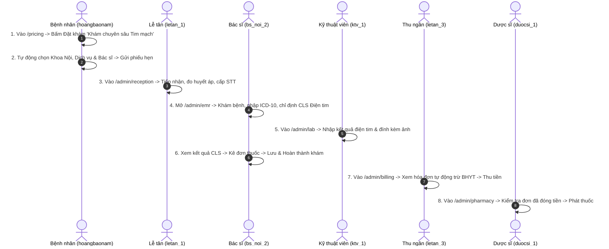

# HƯỚNG DẪN CÀI ĐẶT, VẬN HÀNH VÀ KIỂM THỬ HỆ THỐNG
## H2T Healthcare - Hệ Thống Quản Lý Bệnh Viện & Phòng Khám Đa Khoa
Nền tảng: **Python 3.10+ (Flask Framework)** & **Microsoft SQL Server (100% T-SQL)**

Tài liệu này cung cấp hướng dẫn chi tiết từ A đến Z dành cho giảng viên, hội đồng phản biện, kỹ sư triển khai và người dùng thử nghiệm: từ thiết lập môi trường, nạp cơ sở dữ liệu, khởi chạy ứng dụng đến kịch bản kiểm thử quy trình y tế khép kín cho cả 6 vai trò.

---

## I. YÊU CẦU MÔI TRƯỜNG & HỆ THỐNG

### 1. Phần Cứng Khuyến Nghị
- **CPU**: Intel Core i3 / AMD Ryzen 3 trở lên (khuyến nghị 4 nhân).
- **RAM**: Tối thiểu 4 GB (khuyến nghị 8 GB trở lên khi chạy song song SQL Server và trình duyệt).
- **Ổ cứng**: Còn trống tối thiểu 5 GB.
- **Hệ điều hành**: Windows 10 / 11 64-bit hoặc Windows Server 2016/2019/2022.

### 2. Phần Mềm Bắt Buộc
- **Python**: Phiên bản 3.9, 3.10, 3.11 hoặc 3.12 (khuyến nghị **Python 3.10** hoặc **3.11** 64-bit). Đảm bảo tích chọn *"Add Python to PATH"* khi cài đặt.
- **Hệ quản trị CSDL**: **Microsoft SQL Server** (bản 2017, 2019, 2022 hoặc **SQL Server Express** miễn phí).
- **Driver kết nối**: **Microsoft ODBC Driver 17 for SQL Server** (hoặc ODBC Driver 18 for SQL Server).
- **Công cụ quản trị CSDL (tùy chọn)**: SQL Server Management Studio (SSMS) hoặc Azure Data Studio.

---

## II. CÁC BƯỚC CÀI ĐẶT & THIẾT LẬP DỰ ÁN

### Bước 1: Mở Thư Mục Dự Án & Tạo Môi Trường Ảo (Khuyến Nghị)
Mở cửa sổ dòng lệnh (PowerShell hoặc CMD) tại thư mục gốc dự án:
```powershell
cd "d:\baitap\Khoa Luan\KLCN_QuanLyPhongKhamDaKhoa"
```

Tạo và kích hoạt môi trường ảo Python:
```powershell
# Tạo môi trường ảo
python -m venv venv

# Kích hoạt trên Windows PowerShell:
.\venv\Scripts\Activate.ps1

# (Hoặc kích hoạt trên Command Prompt thông thường: .\venv\Scripts\activate.bat)
```

### Bước 2: Cài Đặt Các Gói Thư Viện Phụ Thuộc
Chạy lệnh cài đặt từ file `requirements.txt`:
```powershell
pip install -r requirements.txt
```

Danh mục các thư viện cốt lõi:
- `flask>=3.0.0`: Micro-framework phát triển Web MVC và RESTful API.
- `pyodbc>=5.3.0`: Driver kết nối và thực thi lệnh T-SQL với Microsoft SQL Server.
- `pillow>=10.0.0`: Xử lý hình ảnh y tế, nén tối ưu WebP và thumbnail kết quả cận lâm sàng.

### Bước 3: Thiết Lập Cơ Sở Dữ Liệu Microsoft SQL Server
Hệ thống sử dụng cơ sở dữ liệu có tên mặc định là: `quan_ly_phong_kham`.

#### Cách A: Sử dụng SQL Server Management Studio (SSMS) - Khuyến nghị
1. Mở SSMS, kết nối tới SQL Server instance của bạn (ví dụ: `localhost` hoặc `.\SQLEXPRESS`).
2. Mở file script SQL có sẵn tại đường dẫn: `database/cosodulieu.sql`.
3. Bấm nút **Execute** (hoặc phím **F5**). Script sẽ tự động tạo cơ sở dữ liệu `quan_ly_phong_kham`, tạo toàn bộ 28 bảng và nạp đầy đủ dữ liệu mẫu chuẩn y khoa.

#### Cách B: Sử dụng dòng lệnh sqlcmd
```powershell
sqlcmd -S localhost -E -i database\cosodulieu.sql
```

### Bước 4: Kiểm Tra Cấu Hình Kết Nối Trong `config.py`
Mở file `config.py` tại thư mục gốc và kiểm tra cấu hình `SQLSERVER_CONFIG`:
```python
SQLSERVER_CONFIG = {
    'driver': '{ODBC Driver 17 for SQL Server}', # Hoặc {ODBC Driver 18 for SQL Server}
    'server': os.environ.get('SQL_SERVER_NAME', 'localhost'), # Tên server SQL (localhost hoặc .\SQLEXPRESS)
    'database': 'quan_ly_phong_kham',
    'trusted_connection': 'yes',                 # Sử dụng Windows Authentication
    'uid': 'sa',                                 # (Nếu dùng SQL Auth)
    'pwd': 'your_password'                       # (Nếu dùng SQL Auth)
}
```

> **Lưu ý Driver 18**: Nếu máy tính sử dụng ODBC Driver 18, có thể bổ sung `'TrustServerCertificate': 'yes'` nếu gặp lỗi SSL Certificate.

---

## III. KHỞI CHẠY HỆ THỐNG

### 1. Khởi Chạy Ứng Dụng Web
Tại thư mục gốc dự án (đã kích hoạt môi trường ảo), thực thi:
```powershell
python app.py
```

Khi màn hình xuất hiện thông báo:
```text
 * Running on http://127.0.0.1:5000 (Press CTRL+C to quit)
 * Restarting with stat
 * Debugger is active!
```
Ứng dụng đã sẵn sàng! Mở trình duyệt web bất kỳ (Chrome, Edge, Firefox, Brave) và truy cập:
👉 **`http://localhost:5000`** hoặc **`http://127.0.0.1:5000`**

### 2. Chế Độ Chạy Mobile Test Server (Tùy Chọn)
Để kiểm thử riêng cổng Mobile API trên port độc lập (port 5001):
```powershell
$env:MOBILE_TOKEN_SECRET="super_secret_mobile_token_key_32bytes_long"
python run_mobile_auth_test_server.py
```

---

## IV. BẢNG TÀI KHOẢN MẪU & MẬT KHẨU MẶC ĐỊNH (71 TÀI KHOẢN)

Hệ thống cho phép đăng nhập linh hoạt bằng:
- **Tên đăng nhập (Username)**
- **Số điện thoại (SĐT)**
- **Mã Bệnh nhân (`BN...`) / Mã Nhân viên (`NV...`)**

### 1. Quản Trị Viên (`ADMIN`) - Mật khẩu: `123456`
| STT | Username / Mã | Số điện thoại | Họ và tên | Chức danh |
| :---: | :--- | :--- | :--- | :--- |
| 1 | `admin` | `0999999999` | Quản Trị Viên Hệ Thống | Giám đốc / Trưởng ban CNTT |

### 2. Nhân Viên Lễ Tân & Thu Ngân (`LETAN`) - Mật khẩu: `123`
| STT | Username / Mã | Số điện thoại | Họ và tên | Vị trí công tác |
| :---: | :--- | :--- | :--- | :--- |
| 1 | `letan_1` | `0908111221` | Nguyễn Thị Lan | Quầy tiếp đón số 1 |
| 2 | `letan_2` | `0908111222` | Trần Thu Huyền | Quầy tiếp đón số 2 |
| 3 | `letan_3` | `0908111223` | Lê Phương Thảo | Quầy thu ngân & Viện phí |
| 4 | `letan_4` | `0908111224` | Phạm Ngọc Bích | Điều phối lịch hẹn |
| 5 | `letan_5` | `0908111225` | Đỗ Thu Hà | Quầy tiếp đón số 3 |

### 3. Bác Sĩ Chuyên Khoa (`BACSI`) - Mật khẩu: `123`
Hệ thống gồm 35 bác sĩ phân bổ đều cho 7 chuyên khoa lâm sàng (mỗi khoa 5 bác sĩ):

#### Khoa Nội Tổng Quát
| STT | Username | Số điện thoại | Họ và tên bác sĩ | Phòng khám |
| :---: | :--- | :--- | :--- | :--- |
| 1 | `bs_noi_1` | `0912111001` | BS. Trần Minh Quân | P.101 Nội Tổng Quát |
| 2 | `bs_noi_2` | `0912111002` | BS. Phạm Anh Tuấn | P.102 Nội Tim Mạch |
| 3 | `bs_noi_3` | `0912111003` | BS. Nguyễn Thu Trang | P.103 Nội Tiêu Hóa |
| 4 | `bs_noi_4` | `0912111004` | BS. Vũ Quốc Hưng | P.104 Nội Hô Hấp |
| 5 | `bs_noi_5` | `0912111005` | BS. Lê Hoài An | P.105 Nội Tiết |

#### Khoa Ngoại Tổng Quát
| STT | Username | Số điện thoại | Họ và tên bác sĩ | Phòng khám |
| :---: | :--- | :--- | :--- | :--- |
| 6 | `bs_ngoai_1` | `0912222001` | BS. Nguyễn Hoàng Nam | P.201 Ngoại Tổng Quát |
| 7 | `bs_ngoai_2` | `0912222002` | BS. Phan Thanh Phong | P.202 Ngoại Chấn Thương |
| 8 | `bs_ngoai_3` | `0912222003` | BS. Đinh Văn Hùng | P.203 Ngoại Tiết Niệu |
| 9 | `bs_ngoai_4` | `0912222004` | BS. Hoàng Đức Lâm | P.204 Ngoại Tiêu Hóa |
| 10 | `bs_ngoai_5` | `0912222005` | BS. Trịnh Văn Long | P.205 Tiểu Phẫu & Thay Băng |

#### Khoa Nhi
| STT | Username | Số điện thoại | Họ và tên bác sĩ | Phòng khám |
| :---: | :--- | :--- | :--- | :--- |
| 11 | `bs_nhi_1` | `0912333001` | BS. Lê Thị Mai | P.301 Khám Nhi Chung |
| 12 | `bs_nhi_2` | `0912333002` | BS. Dương Diệu Linh | P.302 Nhi Hô Hấp |
| 13 | `bs_nhi_3` | `0912333003` | BS. Ngô Đình Quân | P.303 Nhi Dinh Dưỡng |
| 14 | `bs_nhi_4` | `0912333004` | BS. Phạm Thúy Hằng | P.304 Tiêm Chủng Trẻ Em |
| 15 | `bs_nhi_5` | `0912333005` | BS. Đỗ Tuấn Nghĩa | P.305 Nhi Sơ Sinh |

*(Các khoa Răng Hàm Mặt: `bs_rhm_1` đến `bs_rhm_5`; Sản Phụ Khoa: `bs_san_1` đến `bs_san_5`; Tai Mũi Họng: `bs_tmh_1` đến `bs_tmh_5`; Mắt: `bs_mat_1` đến `bs_mat_5` đều có mật khẩu mặc định là `123`).*

### 4. Dược Sĩ & Quản Lý Kho Dược (`DUOCSI`) - Mật khẩu: `123`
| STT | Username / Mã | Số điện thoại | Họ và tên | Chức năng phụ trách |
| :---: | :--- | :--- | :--- | :--- |
| 1 | `duocsi_1` | `0908222331` | Dược sĩ Phạm Hoàng Minh | Quầy phát thuốc BHYT |
| 2 | `duocsi_2` | `0908222332` | Dược sĩ Nguyễn Thị Kim Oanh | Quầy phát thuốc theo yêu cầu |
| 3 | `duocsi_3` | `0908222333` | Dược sĩ Vũ Đình Trọng | Quản lý kho chẵn |
| 4 | `duocsi_4` | `0908222334` | Dược sĩ Hoàng Thanh Trúc | Kiểm nhập thuốc & Hạn dùng |
| 5 | `duocsi_5` | `0908222335` | Dược sĩ Trần Văn Phúc | Theo dõi xuất nhập tồn |

### 5. Kỹ Thuật Viên Cận Lâm Sàng (`KTV`) - Mật khẩu: `123`
| STT | Username / Mã | Số điện thoại | Họ và tên | Bộ phận chuyên môn |
| :---: | :--- | :--- | :--- | :--- |
| 1 | `ktv_1` | `0908333441` | KTV. Võ Anh Đức | Phòng Huyết học - Sinh hóa |
| 2 | `ktv_2` | `0908333442` | KTV. Hoàng Văn Cường | Phòng Chụp X-Quang kỹ thuật số |
| 3 | `ktv_3` | `0908333443` | KTV. Đặng Mỹ Linh | Phòng Siêu âm màu 4D |
| 4 | `ktv_4` | `0908333444` | KTV. Bùi Quốc Tuấn | Phòng Đo Điện tim & Thăm dò |
| 5 | `ktv_5` | `0908333445` | KTV. Lê Thùy Trang | Phòng Xét nghiệm Vi sinh |

### 6. Khách Hàng / Bệnh Nhân (`BENHNHAN`) - Mật khẩu: `123`
| STT | Username / Mã BN | Số điện thoại | Họ và tên | Tình trạng thẻ BHYT |
| :---: | :--- | :--- | :--- | :--- |
| 1 | `hoangbaonam` | `0901234561` | Hoàng Bảo Nam | **Đã có thẻ BHYT** (`DN4790123456789`) |
| 2 | `0926677889` | `0926677889` | Hoàng Mỹ Duyên | **Đã có thẻ BHYT** (`4790445566`) |
| 3 | `0989900112` | `0989900112` | Mai Văn Khiêm | **Chưa có thẻ BHYT** (Khám viện phí 100%) |
| 4 | `0901234562` | `0901234562` | Trần Thị Thu Hà | Đã có thẻ BHYT |
| 5 | `0901234563` | `0901234563` | Nguyễn Văn Hùng | Đã có thẻ BHYT |

---

## V. KỊCH BẢN KIỂM THỬ QUY TRÌNH Y TẾ KHÉP KÍN (END-TO-END DEMO)

Để đánh giá toàn diện hoạt động của hệ thống, người kiểm thử có thể thực hiện tuần tự theo luồng nghiệp vụ 7 bước sau:

### Kịch Bản: Bệnh nhân Hoàng Bảo Nam đặt khám Chuyên sâu Tim mạch -> Khám EMR -> Chỉ định CLS -> Thu ngân BHYT -> Cấp phát thuốc



#### Bước 1: Bệnh nhân đặt khám từ bảng giá
1. Truy cập `http://localhost:5000/pricing`.
2. Tìm dịch vụ *"Khám chuyên sâu Tim mạch và Tăng huyết áp"* (giá gốc 200.000 đ, BHYT trả 80%).
3. Bấm nút **Đặt khám**.
4. Hệ thống chuyển sang trang đặt lịch `http://localhost:5000/patient/booking`:
   - Chuyên khoa *Khoa Nội Tổng Quát* đã được chọn tự động.
   - Hình thức khám *Khám chuyên sâu Tim mạch* được chọn sẵn kèm giá niêm yết 200.000 đ.
   - Tóm tắt phiếu hẹn hiển thị chính xác.
5. Chọn giờ khám phù hợp và bấm **Xác nhận Đặt Lịch**.

#### Bước 2: Lễ tân tiếp đón bệnh nhân tại quầy
1. Đăng xuất và đăng nhập tài khoản Lễ tân: `letan_1` / `123`.
2. Truy cập phân hệ **Tiếp đón** (`/admin/reception`).
3. Tìm bệnh nhân *Hoàng Bảo Nam* trong danh sách chờ tiếp nhận.
4. Nhập chỉ số sinh hiệu (Huyết áp: `120/80`, Mạch: `75`, Nhiệt độ: `36.8`, SpO2: `98%`).
5. Bấm **Tiếp nhận & Cấp số khám**. Bệnh nhân được chuyển thẳng vào buồng khám của bác sĩ.

#### Bước 3: Bác sĩ thực hiện Bệnh án điện tử EMR 4 bước
1. Đăng nhập tài khoản Bác sĩ Nội: `bs_noi_2` / `123`.
2. Truy cập phân hệ **Khám bệnh EMR** (`/admin/emr`).
3. Chọn hồ sơ của bệnh nhân *Hoàng Bảo Nam*:
   - **Bước 1 - Khám lâm sàng**: Nhập triệu chứng, tiền sử, chọn mã bệnh ICD-10: `I10 - Tăng huyết áp vô căn`.
   - **Bước 2 - Chỉ định Cận lâm sàng**: Chọn dịch vụ *"Đo điện tim (ECG)"*. Giao diện hiển thị giá gốc và ghi chú BHYT. Bấm gửi chỉ định.
   - **Bước 3 - Kê đơn thuốc**: Thêm thuốc hạ áp (VD: Amlodipine 5mg, ngày 1 viên buổi sáng x 30 ngày).
   - **Bước 4 - Kết luận & Dặn dò**: Nhập lời dặn, hẹn tái khám sau 30 ngày.
   - Bấm **Hoàn tất khám & Xuất phiếu**. Hệ thống tự động sinh hóa đơn viện phí và đẩy đơn thuốc sang Nhà thuốc.

#### Bước 4: Kỹ thuật viên trả kết quả xét nghiệm
1. Đăng nhập tài khoản KTV: `ktv_1` / `123`.
2. Truy cập phân hệ **Cận lâm sàng** (`/admin/lab`).
3. Tìm chỉ định của bệnh nhân, nhập kết luận: *"Nhịp xoang đều, tần số 75ck/phút, không có rối loạn tái cực"*.
4. Bấm **Trả kết quả xét nghiệm**.

#### Bước 5: Quyết toán viện phí có trừ BHYT
1. Đăng nhập tài khoản Thu ngân: `letan_3` / `123`.
2. Truy cập phân hệ **Viện phí** (`/admin/billing`).
3. Mở hóa đơn vừa sinh của bệnh nhân *Hoàng Bảo Nam*:
   - Tổng chi phí (giá gốc): Gồm tiền khám + tiền điện tim + tiền thuốc.
   - Dòng **Quỹ BHYT chi trả / hoàn trả**: Hiển thị rõ ràng số tiền BHYT đã hỗ trợ khấu trừ.
   - Số tiền thực thu người bệnh thanh toán = `Tổng giá gốc - Quỹ BHYT trả`.
4. Bấm **Xác nhận thanh toán** (Tiền mặt hoặc Chuyển khoản QR). In phiếu thu.

#### Bước 6: Nhà thuốc cấp phát thuốc tự động trừ kho
1. Đăng nhập tài khoản Dược sĩ: `duocsi_1` / `123`.
2. Truy cập phân hệ **Quầy thuốc** (`/admin/pharmacy`).
3. Đơn thuốc của bệnh nhân lúc này đã chuyển sang trạng thái xanh: `Đã đóng viện phí - Đủ điều kiện phát thuốc`.
4. Bấm **Xác nhận phát thuốc**.
5. Hệ thống cập nhật trạng thái đơn thuốc hoàn tất và tự động trừ số lượng tồn kho tương ứng trong bảng `thuoc`.

---

## VI. BẬT/TẮT CHẾ ĐỘ BẢO TRÌ & SAO LƯU CƠ SỞ DỮ LIỆU

### 1. Bật/Tắt Chế Độ Bảo Trì Độc Lập
1. Đăng nhập tài khoản Admin: `admin` / `123456`.
2. Vào mục **Sao lưu & Bảo trì** (`/admin/backups`).
3. Tại khối **Cài đặt chế độ bảo trì hệ thống**:
   - Gạt nút **Bảo trì Cổng Bệnh nhân (`maintenance_patient`)**: Bệnh nhân vẫn xem được trang chủ, nhưng khi bấm Đặt khám, Bệnh án hoặc Viện phí sẽ nhận thông báo hệ thống đang bảo trì.
   - Gạt nút **Bảo trì Cổng Nhân viên (`maintenance_staff`)**: Nhân viên y tế tạm thời không thao tác phân hệ nghiệp vụ để bảo trì kỹ thuật.
4. Sau khi hoàn thành nâng cấp, gạt tắt để mở lại bình thường.

### 2. Sao Lưu & Phục Hồi CSDL
- **Tạo bản sao lưu tức thì**: Bấm nút **Sao lưu CSDL ngay** trên giao diện `/admin/backups`. File `.bak` sẽ được lưu tự động vào thư mục `backups/`.
- **Tải file sao lưu**: Bấm biểu tượng download để lưu trữ offline.
- **Phục hồi CSDL**: Chọn bản backup mong muốn và bấm **Phục hồi CSDL** để đưa toàn bộ dữ liệu về trạng thái sao lưu tương ứng.

---

## VII. BỘ KIỂM THỬ TỰ ĐỘNG (AUTOMATED TEST SUITE)

Hệ thống tích hợp sẵn 33 bộ unit test hồi quy kiểm tra toàn diện:
```powershell
python -m unittest discover tests
```

Kết quả mong đợi:
```text
Ran 33 tests in 1.962s
OK
```

Chạy kịch bản kiểm tra tích hợp BHYT và luồng đặt khám tự động:
```powershell
python scratch/test_preselection_booking.py
```

---

## VIII. XỬ LÝ SỰ CỐ THƯỜNG GẶP (TROUBLESHOOTING)

1. **Lỗi `Login failed for user` hoặc `Cannot connect to SQL Server`**:
   - Mở `SQL Server Configuration Manager`, kiểm tra dịch vụ `SQL Server (MSSQLSERVER)` hoặc `SQL Server (SQLEXPRESS)` đã ở trạng thái **Running**.
   - Kiểm tra giao thức `TCP/IP` đã được **Enabled**.
   - Mở file `config.py` và đảm bảo tên server trong `'server'` khớp với tên SQL instance trên máy của bạn (ví dụ `localhost` hoặc `.\SQLEXPRESS`).

2. **Lỗi `Can't open lib 'ODBC Driver 17 for SQL Server'`**:
   - Máy tính chưa cài đặt ODBC Driver. Tải và cài đặt miễn phí từ trang chủ Microsoft: *"Microsoft ODBC Driver 17 for SQL Server"*.
   - Hoặc nếu máy đang có ODBC Driver 18, đổi giá trị `'driver'` trong `config.py` thành `'{ODBC Driver 18 for SQL Server}'`.

3. **Cổng 5000 bị chiếm dụng (Port 5000 in use)**:
   - Chạy ứng dụng trên cổng khác:
     ```powershell
     python -c "from app import app; app.run(port=5050, debug=True)"
     ```
   - Truy cập: `http://localhost:5050`.
