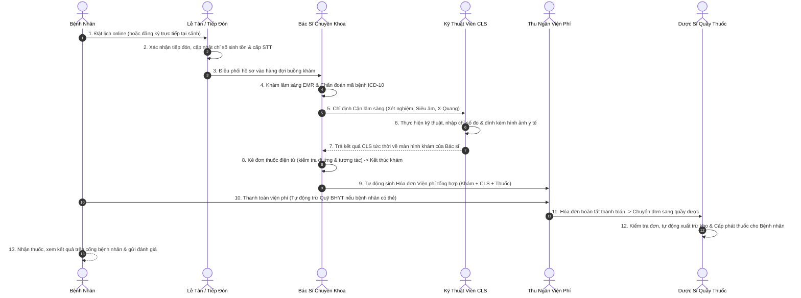

# HỆ THỐNG QUẢN LÝ BỆNH VIỆN & PHÒNG KHÁM ĐA KHOA H2T HEALTHCARE (HIS & EMR)

[](https://www.python.org/)
[](https://flask.palletsprojects.com/)
[]()
[-red.svg)]()
[]()
[]()
[-success.svg)]()

Hệ thống ứng dụng Web quản lý toàn diện phòng khám đa khoa và bệnh viện theo mô hình kiến trúc MVC (Model - View - Controller), vận hành chuyên biệt 100% trên nền tảng **Microsoft SQL Server**. Hệ thống số hóa trọn vẹn quy trình y tế khép kín: từ cổng thông tin công cộng, đặt lịch khám ma trận hai chiều thông minh, bàn tiếp đón cấp số thứ tự tự động, bệnh án điện tử EMR 4 bước liên hoàn, điều phối cận lâm sàng và hình ảnh y tế, quản lý kho dược trừ tồn kho tự động, quyết toán viện phí tự động khấu trừ quỹ BHYT chuẩn tuyến, hệ thống sao lưu CSDL định kỳ, động cơ bảo trì độc lập hai tệp người dùng, đến bộ REST API chuẩn hóa cho ứng dụng di động.

---

## MỤC LỤC
1. [Sơ Đồ Kiến Trúc & Luồng Vận Hành](#1-sơ-đồ-kiến-trúc--luồng-vận-hành)
2. [Cấu Trúc Thư Mục Dự Án](#2-cấu-trúc-thư-mục-dự-án)
3. [Hướng Dẫn Cài Đặt & Khởi Chạy Nhanh](#3-hướng-dẫn-cài-đặt--khởi-chạy-nhanh)
4. [Ma Trận Phân Quyền Hệ Thống (RBAC)](#4-ma-trận-phân-quyền-hệ-thống-rbac)
5. [Toàn Bộ Danh Sách 71 Tài Khoản Mẫu](#5-toàn-bộ-danh-sách-71-tài-khoản-mẫu)
6. [Chi Tiết 28 Bảng Cơ Sở Dữ Liệu SQL Server](#6-chi-tiết-28-bảng-cơ-sở-dữ-liệu-sql-server)
7. [Các Phân Hệ Chức Năng Nòng Cốt](#7-các-phân-hệ-chức-năng-nòng-cốt)
8. [Hệ Thống REST API & Mobile API](#8-hệ-thống-rest-api--mobile-api)
9. [Cơ Chế Nghiệp Vụ Nâng Cao & Thuật Toán](#9-cơ-chế-nghiệp-vụ-nâng-cao--thuật-toán)
10. [Kiểm Thử & Đảm Bảo Chất Lượng](#10-kiểm-thử--đảm-bảo-chất-lượng)

---

## 1. SƠ ĐỒ KIẾN TRÚC & LUỒNG VẬN HÀNH

### Kiến Trúc Hệ Thống (MVC & Layered Security)

```mermaid
flowchart TD
    Client["Client (Trình duyệt Web Desktop/Mobile & Mobile App)"] --> AppGateway["Flask Application Gateway (app.py)"]
    
    subgraph SecurityLayer["Tầng Bảo Mật & Kiểm Soát Truy Cập (core/security.py)"]
        RBAC["Kiểm soát quyền truy cập 6 vai trò (RBAC Decorators)"]
        Sanitize["Lọc dữ liệu đầu vào & Chống tấn công XSS / CSRF"]
        MaintEngine["Động cơ Bảo trì Độc lập (Bệnh nhân / Nhân viên)"]
    end
    
    AppGateway --> SecurityLayer

    subgraph ControllerLayer["Tầng Điều Khiển Nghiệp Vụ (controllers/)"]
        AuthController["auth_controller.py (Đăng nhập Username/SĐT, Đổi mật khẩu)"]
        HomeController["home_controller.py (Trang chủ, Bảng giá, Chuyên khoa, Bác sĩ)"]
        PatientController["patient_controller.py (Đặt lịch ma trận, Bệnh án, Viện phí)"]
        AdminController["admin_controller.py (EMR, Tiếp đón, Kho dược, Viện phí, Báo cáo)"]
        ApiController["api_controller.py (REST API nội bộ)"]
        MobileController["mobile_patient_controller.py & mobile_auth_controller.py"]
    end
    
    SecurityLayer --> ControllerLayer

    subgraph ModelLayer["Tầng Mô Hình Dữ Liệu Thực Thể (models/)"]
        UserModel["UserModel & PatientModel"]
        AppointmentModel["AppointmentModel (Ma trận ca trực hai chiều)"]
        MedicalRecordModel["MedicalRecordModel (EMR lâm sàng 4 bước)"]
        MedicineModel["MedicineModel (Kho dược & Tương tác thuốc)"]
        BillingModel["BillingModel (Hóa đơn & Khấu trừ BHYT)"]
        ClinicModel["ClinicModel & BackupModel"]
    end
    
    ControllerLayer --> ModelLayer

    subgraph DatabaseLayer["Hệ Quản Trị CSDL Microsoft SQL Server"]
        SQL[(Database: quan_ly_phong_kham<br>28 Bảng Thực Thể Chuẩn T-SQL)]
    end
    
    ModelLayer -->|pyodbc Connection Pooling / Parameterized SQL| DatabaseLayer
```


### Luồng Vận Hành Y Tế Khép Kín (End-to-End Workflow)


---

## 2. CẤU TRÚC THƯ MỤC DỰ ÁN

```text
KLCN_QuanLyPhongKhamDaKhoa/
├── app.py                         # Điểm khởi chạy ứng dụng Flask, cấu hình Blueprints & Middleware
├── config.py                      # Cấu hình kết nối SQL Server, SMTP, Auto-backup, Tọa độ bản đồ
├── requirements.txt               # Danh mục thư viện Python phụ thuộc
├── README.md                      # Tài liệu kỹ thuật tổng quan và hướng dẫn dự án
├── HUONGDAN.md                    # Cẩm nang hướng dẫn chi tiết cài đặt, cấu hình & kiểm thử
├── run_mobile_auth_test_server.py # Server phụ trợ kiểm thử Mobile API độc lập
│
├── controllers/                   # Tầng điều khiển nghiệp vụ (Controllers)
│   ├── admin_controller.py        #   - Nghiệp vụ quản trị: EMR, tiếp đón, kho dược, viện phí, nhân sự
│   ├── api_controller.py          #   - Toàn bộ REST API phục vụ Web App
│   ├── auth_controller.py         #   - Xác thực: Đăng nhập (Username/SĐT/Mã), đăng ký, đổi mật khẩu
│   ├── home_controller.py         #   - Cổng công cộng: Trang chủ, bảng giá, chuyên khoa, bác sĩ, bảo trì
│   ├── mobile_auth_controller.py  #   - REST API xác thực cho ứng dụng di động
│   ├── mobile_patient_controller.py # - REST API nghiệp vụ bệnh nhân cho ứng dụng di động
│   └── patient_controller.py      #   - Cổng bệnh nhân: Đặt lịch ma trận, bệnh án, kết quả CLS, viện phí
│
├── models/                        # Tầng mô hình dữ liệu & nghiệp vụ CSDL (Models)
│   ├── appointment_model.py       #   - Ma trận lịch hẹn 2 chiều, phân ca trực, xếp hàng khám bệnh
│   ├── article_model.py           #   - Tin tức y tế, cẩm nang sức khỏe cộng đồng
│   ├── backup_model.py            #   - Động cơ sao lưu CSDL (.bak) & khôi phục tự động
│   ├── banner_model.py            #   - Quản lý banner truyền thông trang chủ
│   ├── billing_model.py           #   - Viện phí, chi tiết hóa đơn, thuật toán khấu trừ BHYT
│   ├── clinic_model.py            #   - Chuyên khoa, phòng khám, dịch vụ kỹ thuật, thống kê dashboard
│   ├── feedback_model.py          #   - Đánh giá của người bệnh, hòm thư góp ý
│   ├── medical_record_model.py    #   - Bệnh án điện tử EMR, sinh hiệu, chỉ định CLS, đơn thuốc
│   ├── medicine_model.py          #   - Kho dược phẩm, cảnh báo dị ứng & tương tác thuốc
│   ├── notification_model.py      #   - Thông báo đa kênh thời gian thực
│   ├── patient_model.py           #   - Hồ sơ bệnh nhân, quản lý thẻ BHYT, mã định danh BN
│   ├── system_setting_model.py    #   - Cấu hình hệ thống, cờ bật/tắt bảo trì độc lập
│   └── user_model.py              #   - Tài khoản người dùng, phân quyền RBAC, hồ sơ cán bộ nhân viên
│
├── core/                          # Thư viện lõi, tiện ích bảo mật và dịch vụ hệ thống
│   ├── billing_policy.py          #   - Chính sách và quy tắc giảm trừ chi phí bảo hiểm
│   ├── catalog.py                 #   - Bộ nạp danh mục y tế dùng chung
│   ├── clinical_data.py           #   - Chuẩn hóa hiển thị dữ liệu lâm sàng
│   ├── database.py                #   - Kết nối Microsoft SQL Server (Connection Pooling, logging an toàn)
│   ├── medical_media.py           #   - Xử lý lưu trữ và phân phối hình ảnh cận lâm sàng an toàn
│   ├── mssql_test_database.py     #   - Môi trường kiểm thử độc lập cho SQL Server
│   ├── notification_service.py    #   - Dịch vụ đẩy thông báo thời gian thực
│   └── security.py                #   - RBAC decorators, băm mật khẩu, chống CSRF, chống XSS
│
├── database/                      # Cơ sở dữ liệu Microsoft SQL Server
│   ├── cosodulieu.sql             #   - Script T-SQL trọn gói: Schema 28 bảng và toàn bộ dữ liệu mẫu
│   ├── legacy_bridge.py           #   - Module tương thích ngược
│   └── migrations/                #   - Các bản script nâng cấp CSDL theo thời gian
│
├── docs/                          # Tài liệu chuyên sâu
│   ├── huong_dan_chay.md          #   - Hướng dẫn cài đặt và thiết lập SQL Server
│   ├── kiem_thu_thu_cong_toan_dien.md # - Cẩm nang kiểm thử thủ công 10 chức năng
│   └── QUY_TRINH_NGHIEP_VU_HE_THONG.md # - Tài liệu quy trình nghiệp vụ y tế
│
├── templates/                     # Giao diện người dùng (Jinja2 HTML Templates)
│   ├── layouts/base.html          #   - Khung giao diện chuẩn, Tailwind CSS, Toast, Modal animation
│   ├── admin/                     #   - Giao diện Bác sĩ, Lễ tân, Dược sĩ, KTV, Thu ngân, Quản trị viên
│   ├── auth/                      #   - Giao diện đăng nhập, đăng ký, đổi mật khẩu cưỡng bức
│   ├── patient/                   #   - Giao diện Cổng bệnh nhân trực tuyến
│   ├── home.html                  #   - Trang chủ chính thức của phòng khám
│   ├── pricing.html               #   - Bảng giá dịch vụ 4 cột chuẩn BHYT
│   ├── departments.html           #   - Danh bạ chuyên khoa & phòng khám
│   ├── doctors.html               #   - Danh bạ đội ngũ bác sĩ chuyên môn
│   ├── maintenance_patient.html   #   - Giao diện thông báo bảo trì cho Bệnh nhân
│   └── maintenance_staff.html     #   - Giao diện thông báo bảo trì cho Nhân viên
│
├── static/                        # Tài nguyên tĩnh (CSS, JS, Fonts, Images)
├── backups/                       # Thư mục lưu trữ các bản sao lưu CSDL (.bak)
└── tests/                         # Bộ kiểm thử tự động (Unit Tests & Integration Tests)
    └── test_mobile_patient_api.py #   - 33 bài kiểm thử tự động bảo đảm an toàn hồi quy
```

---

## 3. HƯỚNG DẪN CÀI ĐẶT & KHỞI CHẠY NHANH

Chi tiết từng bước cấu hình vui lòng xem tại file [`HUONGDAN.md`](HUONGDAN.md). Dưới đây là tóm tắt nhanh:

### Bước 1: Cài đặt thư viện phụ thuộc
```powershell
pip install -r requirements.txt
```

### Bước 2: Đồng bộ Cơ sở dữ liệu tự động (1-Click)
Chạy lệnh đồng bộ tự động để hệ thống tự động phát hiện instance SQL Server, kiểm tra driver ODBC và nạp đầy đủ toàn bộ 28 bảng dữ liệu chuẩn y khoa:
```powershell
python sync_db.py
```
* **Chế độ mặc định (Safe Sync)**: Tự động bảo toàn 100% dữ liệu bạn đã tạo trước đó trên máy, chỉ tạo mới bảng và bổ sung cột còn thiếu (không xóa bảng, không mất dữ liệu cũ).
* **Sao chép dữ liệu giữa 2 máy**: Bỏ file `.bak` vào thư mục `backups/` và chạy `python sync_db.py --restore`.
* **Làm mới dữ liệu từ đầu (Reset)**: Chạy `python sync_db.py --fresh` (chỉ dùng khi muốn xóa sạch để quay về dữ liệu mẫu xuất xưởng).
*(Lưu ý: Không nên chạy thẳng `database/cosodulieu.sql` trên SSMS nếu muốn giữ lại dữ liệu tự tạo, vì file SQL đó có lệnh DROP TABLE sẽ xóa sạch dữ liệu cũ).*

### Bước 3: Cấu hình kết nối CSDL trong `config.py`
Đảm bảo thông số `SQLSERVER_CONFIG` trong `config.py` khớp với máy của bạn (mặc định sử dụng Windows Authentication `trusted_connection: 'yes'`).

### Bước 4: Khởi chạy ứng dụng
```powershell
python app.py
```
Mở trình duyệt truy cập: 👉 **`http://localhost:5000`**

---

## 4. MA TRẬN PHÂN QUYỀN HỆ THỐNG (RBAC)

Hệ thống thiết lập 6 vai trò người dùng chuẩn mực y tế, kiểm soát độc lập bằng decorator `@roles_required`:

| Phân Hệ & Hành Động Nghiệp Vụ | ADMIN | BACSI | LETAN | DUOCSI | KTV | BENHNHAN | GUEST |
| :--- | :---: | :---: | :---: | :---: | :---: | :---: | :---: |
| **Xem Trang chủ, Bảng giá, Chuyên khoa, Bác sĩ** | ✓ | ✓ | ✓ | ✓ | ✓ | ✓ | ✓ |
| **Đặt lịch khám bệnh trực tuyến (Ma trận 2 chiều)**| — | — | — | — | — | ✓ | Chuyển Login |
| **Xem Bệnh án cá nhân, Đơn thuốc, Kết quả CLS** | — | — | — | — | — | ✓ | — |
| **Tiếp đón tại sảnh, Đo sinh hiệu ban đầu, Cấp STT**| ✓ | — | ✓ | — | — | — | — |
| **Quản lý danh sách Lịch hẹn (Duyệt / Hủy / Đổi giờ)**| ✓ | ✓ | ✓ | — | — | — | — |
| **Thực hiện Khám EMR 4 bước, Kê đơn thuốc điện tử**| ✓ | ✓ | — | — | — | — | — |
| **Nhập chỉ số Xét nghiệm, Tải ảnh Chẩn đoán hình ảnh**| ✓ | — | — | — | ✓ | — | — |
| **Duyệt đơn thuốc, Cấp phát thuốc & Trừ kho tự động**| ✓ | — | — | ✓ | — | — | — |
| **Thu ngân, Quyết toán Viện phí, Trừ BHYT, In hóa đơn**| ✓ | — | ✓ | — | — | — | — |
| **Phân ca trực hàng tuần, Điều phối buồng khám** | ✓ | — | — | — | — | — | — |
| **Báo cáo thống kê tài chính, Lượt khám, Thuốc** | ✓ | — | — | — | — | — | — |
| **Quản trị Tài khoản, Đổi vai trò, Reset mật khẩu** | ✓ | — | — | — | — | — | — |
| **Sao lưu CSDL & Bật/Tắt chế độ Bảo trì hệ thống** | ✓ | — | — | — | — | — | — |

---

## 5. TOÀN BỘ DANH SÁCH 71 TÀI KHOẢN MẪU

Hệ thống hỗ trợ đăng nhập linh hoạt bằng:
- **Tên đăng nhập (Username)**
- **Số điện thoại (SĐT)**
- **Mã Bệnh nhân (`BN...`) / Mã Nhân viên (`NV...`)**

### 5.1 Quản Trị Viên (`ADMIN`) - 1 Tài khoản (Mật khẩu: `123456`)
| STT | Tên đăng nhập | Số điện thoại | Họ và tên | Chức vụ |
| :---: | :--- | :--- | :--- | :--- |
| 1 | `admin` | `0999999999` | Quản Trị Viên Hệ Thống | Giám đốc / Trưởng ban CNTT |

### 5.2 Nhân Viên Lễ Tân & Thu Ngân (`LETAN`) - 5 Tài khoản (Mật khẩu: `123`)
| STT | Tên đăng nhập | Số điện thoại | Họ và tên | Vị trí phân công |
| :---: | :--- | :--- | :--- | :--- |
| 1 | `letan_1` | `0908111221` | Nguyễn Thị Lan | Quầy tiếp đón số 1 |
| 2 | `letan_2` | `0908111222` | Trần Thu Huyền | Quầy tiếp đón số 2 |
| 3 | `letan_3` | `0908111223` | Lê Phương Thảo | Quầy thu ngân viện phí |
| 4 | `letan_4` | `0908111224` | Phạm Ngọc Bích | Điều phối lịch hẹn |
| 5 | `letan_5` | `0908111225` | Đỗ Thu Hà | Quầy tiếp đón số 3 |

### 5.3 Bác Sĩ Chuyên Khoa (`BACSI`) - 35 Tài khoản (Mật khẩu: `123`)
Gồm 35 bác sĩ chia đều cho 7 chuyên khoa lâm sàng (mỗi khoa 5 bác sĩ trực ca):

#### Khoa Nội Tổng Quát
| STT | Tên đăng nhập | Số điện thoại | Họ và tên bác sĩ | Phòng khám trực |
| :---: | :--- | :--- | :--- | :--- |
| 1 | `bs_noi_1` | `0912111001` | BS. Trần Minh Quân | P.101 Nội Tổng Quát |
| 2 | `bs_noi_2` | `0912111002` | BS. Phạm Anh Tuấn | P.102 Nội Tim Mạch |
| 3 | `bs_noi_3` | `0912111003` | BS. Nguyễn Thu Trang | P.103 Nội Tiêu Hóa |
| 4 | `bs_noi_4` | `0912111004` | BS. Vũ Quốc Hưng | P.104 Nội Hô Hấp |
| 5 | `bs_noi_5` | `0912111005` | BS. Lê Hoài An | P.105 Nội Tiết |

#### Khoa Ngoại Tổng Quát
| STT | Tên đăng nhập | Số điện thoại | Họ và tên bác sĩ | Phòng khám trực |
| :---: | :--- | :--- | :--- | :--- |
| 6 | `bs_ngoai_1` | `0912222001` | BS. Nguyễn Hoàng Nam | P.201 Ngoại Tổng Quát |
| 7 | `bs_ngoai_2` | `0912222002` | BS. Phan Thanh Phong | P.202 Ngoại Xương Khớp |
| 8 | `bs_ngoai_3` | `0912222003` | BS. Đinh Văn Hùng | P.203 Ngoại Tiết Niệu |
| 9 | `bs_ngoai_4` | `0912222004` | BS. Hoàng Đức Lâm | P.204 Ngoại Tiêu Hóa |
| 10 | `bs_ngoai_5` | `0912222005` | BS. Trịnh Văn Long | P.205 Tiểu Phẫu & Vết Thương |

#### Khoa Nhi
| STT | Tên đăng nhập | Số điện thoại | Họ và tên bác sĩ | Phòng khám trực |
| :---: | :--- | :--- | :--- | :--- |
| 11 | `bs_nhi_1` | `0912333001` | BS. Lê Thị Mai | P.301 Khám Nhi Chung |
| 12 | `bs_nhi_2` | `0912333002` | BS. Dương Diệu Linh | P.302 Nhi Hô Hấp |
| 13 | `bs_nhi_3` | `0912333003` | BS. Ngô Đình Quân | P.303 Nhi Dinh Dưỡng |
| 14 | `bs_nhi_4` | `0912333004` | BS. Phạm Thúy Hằng | P.304 Tiêm Chủng Trẻ Em |
| 15 | `bs_nhi_5` | `0912333005` | BS. Đỗ Tuấn Nghĩa | P.305 Nhi Sơ Sinh |

*(Các chuyên khoa còn lại: Răng Hàm Mặt `bs_rhm_1` đến `bs_rhm_5`; Sản Phụ Khoa `bs_san_1` đến `bs_san_5`; Tai Mũi Họng `bs_tmh_1` đến `bs_tmh_5`; Mắt `bs_mat_1` đến `bs_mat_5` đều có mật khẩu mặc định là `123`).*

### 5.4 Dược Sĩ Quản Lý Kho Dược (`DUOCSI`) - 5 Tài khoản (Mật khẩu: `123`)
| STT | Tên đăng nhập | Số điện thoại | Họ và tên | Chức năng phụ trách |
| :---: | :--- | :--- | :--- | :--- |
| 1 | `duocsi_1` | `0908222331` | Dược sĩ Phạm Hoàng Minh | Quầy phát thuốc BHYT |
| 2 | `duocsi_2` | `0908222332` | Dược sĩ Nguyễn Thị Kim Oanh | Quầy thuốc dịch vụ |
| 3 | `duocsi_3` | `0908222333` | Dược sĩ Vũ Đình Trọng | Quản lý kho chẵn |
| 4 | `duocsi_4` | `0908222334` | Dược sĩ Hoàng Thanh Trúc | Kiểm định hạn dùng |
| 5 | `duocsi_5` | `0908222335` | Dược sĩ Trần Văn Phúc | Báo cáo xuất nhập tồn |

### 5.5 Kỹ Thuật Viên Cận Lâm Sàng (`KTV`) - 5 Tài khoản (Mật khẩu: `123`)
| STT | Tên đăng nhập | Số điện thoại | Họ và tên | Bộ phận chuyên môn |
| :---: | :--- | :--- | :--- | :--- |
| 1 | `ktv_1` | `0908333441` | KTV. Võ Anh Đức | Phòng Xét nghiệm Huyết học |
| 2 | `ktv_2` | `0908333442` | KTV. Hoàng Văn Cường | Phòng Chụp X-Quang kỹ thuật số |
| 3 | `ktv_3` | `0908333443` | KTV. Đặng Mỹ Linh | Phòng Siêu âm 4D |
| 4 | `ktv_4` | `0908333444` | KTV. Bùi Quốc Tuấn | Phòng Đo Điện tim & Điện não |
| 5 | `ktv_5` | `0908333445` | KTV. Lê Thùy Trang | Phòng Xét nghiệm Sinh hóa |

### 5.6 Khách Hàng / Bệnh Nhân (`BENHNHAN`) - 20 Tài khoản (Mật khẩu: `123`)
| STT | Tên đăng nhập / Mã BN | Số điện thoại | Họ và tên | Tình trạng thẻ BHYT |
| :---: | :--- | :--- | :--- | :--- |
| 1 | `hoangbaonam` | `0901234561` | Hoàng Bảo Nam | **Đã có BHYT** (`DN4790123456789`) |
| 2 | `0926677889` | `0926677889` | Hoàng Mỹ Duyên | **Đã có BHYT** (`4790445566`) |
| 3 | `0989900112` | `0989900112` | Mai Văn Khiêm | **Chưa có BHYT** (Khám thu 100% giá gốc) |
| 4 | `0901234562` | `0901234562` | Trần Thị Thu Hà | Đã có thẻ BHYT |
| 5 | `0901234563` | `0901234563` | Nguyễn Văn Hùng | Đã có thẻ BHYT |
| 6 | `0901234564` | `0901234564` | Lê Minh Anh | Đã có thẻ BHYT |
| 7 | `0901234565` | `0901234565` | Phạm Đức Trọng | Đã có thẻ BHYT |
| 8 | `0901234566` | `0901234566` | Đỗ Thị Bích Ngân | Đã có thẻ BHYT |
| 9 | `0901234567` | `0901234567` | Vũ Đình Khang | Đã có thẻ BHYT |
| 10 | `0901234568` | `0901234568` | Bùi Tuyết Mai | Đã có thẻ BHYT |
| 11 | `0901234569` | `0901234569` | Đặng Quốc Bảo | Đã có thẻ BHYT |
| 12 | `0901234570` | `0901234570` | Phan Mỹ Duyên | Đã có thẻ BHYT |
| 13 | `0981122334` | `0981122334` | Lê Hoàng Long | Đã có thẻ BHYT |
| 14 | `0972233445` | `0972233445` | Vũ Thị Bích Ngọc | Đã có thẻ BHYT |
| 15 | `0963344556` | `0963344556` | Đặng Quốc Bảo | Đã có thẻ BHYT |
| 16 | `0944455667` | `0944455667` | Phạm Thanh Thảo | Đã có thẻ BHYT |
| 17 | `0935566778` | `0935566778` | Trịnh Đình Trọng | Đã có thẻ BHYT |
| 18 | `0917788990` | `0917788990` | Bùi Hải Đăng | Đã có thẻ BHYT |
| 19 | `0908899001` | `0908899001` | Nguyễn Khánh Vy | Đã có thẻ BHYT |
| 20 | `0970011223` | `0970011223` | Đỗ Thị Kim Chi | Đã có thẻ BHYT |

---

## 6. CHI TIẾT 28 BẢNG CƠ SỞ DỮ LIỆU SQL SERVER

Cơ sở dữ liệu Microsoft SQL Server `quan_ly_phong_kham` gồm **28 bảng** chuẩn hóa:

| Bảng CSDL | Số Bản Ghi | Mục Đích Nghiệp Vụ & Quan Hệ Chính |
| :--- | :---: | :--- |
| `lich_lam_viec` | **5,598** | Số hóa ca trực (Sáng/Chiều/Tối) của 35 bác sĩ. Khóa ngoại tới `bac_si`, `nhan_vien`, `phong_kham`. |
| `thong_bao` | **1,263** | Thông báo tức thời thời gian thực (SSE + In-app). Khóa ngoại tới `tai_khoan`. |
| `audit_log` | **505** | Nhật ký giám sát an ninh (Tài khoản, hành vi, IP, thời gian). |
| `chi_tiet_hoa_don` | **238** | Bóc tách từng hạng mục chi phí: Tiền khám, Tiền CLS, Tiền thuốc. Khóa ngoại `hoa_don_id`. |
| `lich_hen` | **163** | Phiếu hẹn khám trực tuyến và tại quầy. Khóa ngoại tới `benh_nhan`, `chuyen_khoa`, `bac_si`. |
| `hoa_don` | **154** | Hóa đơn viện phí, lưu tổng giá gốc, tiền BHYT chi trả, tiền thực thu. Khóa ngoại `phieu_kham_id`. |
| `phieu_kham` | **132** | Bệnh án điện tử EMR, triệu chứng, chẩn đoán ICD-10, hướng điều trị, ngày tái khám. |
| `tai_khoan` | **71** | Tài khoản định danh đăng nhập toàn hệ thống, mã hóa mật khẩu, cờ đổi mật khẩu. |
| `chi_tiet_don_thuoc`| **67** | Từng loại thuốc trong đơn, liều dùng (Sáng-Trưa-Chiều-Tối), số ngày. Khóa ngoại `don_thuoc_id`. |
| `phan_hoi` | **67** | Đánh giá sao (1-5) và bình luận trải nghiệm của bệnh nhân sau khám. |
| `dich_vu` | **66** | Biểu giá niêm yết 66 dịch vụ kỹ thuật, khám và xét nghiệm; tỷ lệ quỹ BHYT chi trả. |
| `lich_su_nhac_nho` | **55** | Nhật ký thông báo nhắc nhở lịch hẹn và nhắc tái khám gửi cho người bệnh. |
| `nhan_vien` | **51** | Hồ sơ cán bộ nhân viên y tế, hành chính. Khóa ngoại `tai_khoan_id`, `chuyen_khoa_id`. |
| `chi_tiet_chi_dinh`| **49** | Từng mục cận lâm sàng, kết quả đo lường, kết luận và file ảnh y tế đính kèm. |
| `don_thuoc` | **42** | Đơn thuốc điện tử do bác sĩ kê đơn trong phiên khám. Khóa ngoại `phieu_kham_id`. |
| `phong_kham` | **40** | Danh bạ 40 buồng khám vật lý phân bổ theo 8 chuyên khoa. |
| `bac_si` | **35** | Học vị, chuyên môn, kinh nghiệm, giá khám của 35 bác sĩ. Khóa ngoại `nhan_vien_id`. |
| `phieu_chi_dinh` | **34** | Phiếu tổng hợp các chỉ định CLS phát sinh từ phiên khám bệnh EMR. |
| `lich_su_sao_luu` | **27** | Lịch sử các bản sao lưu CSDL SQL Server (.bak) kèm dung lượng và trạng thái. |
| `chi_so_sinh_ton` | **22** | Mạch, nhiệt độ, huyết áp tâm thu/tâm trương, SpO2, cân nặng, chiều cao, chỉ số BMI. |
| `thuoc` | **21** | Kho dược: Mã thuốc, biệt dược, hoạt chất, tồn kho, hạn dùng, chống chỉ định. |
| `benh_nhan` | **20** | Hồ sơ bệnh nhân: Mã BN, CCCD, mã thẻ BHYT, tiền sử bệnh, dị ứng. |
| `hom_thu_gop_y` | **12** | Ý kiến phản ánh của người dân gửi qua hòm thư điện tử. |
| `chuyen_khoa` | **8** | 8 khoa chuyên môn (Nội, Ngoại, Nhi, Răng Hàm Mặt, Sản, Tai Mũi Họng, Mắt, Cận Lâm Sàng). |
| `cai_dat_he_thong` | **6** | Cấu hình bảo trì độc lập (`maintenance_patient`, `maintenance_staff`), tên cơ sở y tế. |
| `vai_tro` | **6** | 6 vai trò người dùng chuẩn: `ADMIN`, `BACSI`, `LETAN`, `DUOCSI`, `KTV`, `BENHNHAN`. |
| `bai_viet` | **3** | Cẩm nang y khoa và tin tức phòng bệnh cộng đồng. |
| `banner` | **3** | Banner slider truyền thông tại trang chủ. |

---

## 7. CÁC PHÂN HỆ CHỨC NĂNG NÒNG CỐT

### 7.1 Cổng Thông Tin Y Tế Công Khai (Public Portal)
- **Trang chủ ([`templates/home.html`](templates/home.html))**: Hiển thị tổng quan về phòng khám, đội ngũ bác sĩ ngẫu nhiên từ CSDL thực tế, nhận xét tích cực từ bệnh nhân, quy trình khám bệnh trực quan và liên kết đặt lịch nhanh.
- **Bảng giá viện phí 4 cột ([`templates/pricing.html`](templates/pricing.html))**: Phân loại theo 8 khoa; bảng giá gồm đúng 4 cột: `Tên Dịch Vụ` — `Giá Gốc` — `Giá Nếu Có BHYT (Kèm % và tiền trừ)` — `Đặt Khám`. Mỗi nút *Đặt Khám* tự động truyền tham số dịch vụ và khoa tương ứng.
- **Chuyên khoa & Bác sĩ ([`templates/departments.html`](templates/departments.html), [`templates/doctors.html`](templates/doctors.html))**: Danh mục chuyên môn, phòng khám phụ trách, tình trạng làm việc trong ngày (Đang trực / Ngoài giờ) và liên kết đặt lịch cá nhân.

### 7.2 Cổng Bệnh Nhân Trực Tuyến (Patient Portal)
- **Đặt lịch ma trận hai chiều ([`templates/patient/booking.html`](templates/patient/booking.html))**:
  - Tự động nhận diện Chuyên khoa, Dịch vụ kỹ thuật hoặc Bác sĩ được chỉ định từ đường dẫn chuyển tiếp.
  - Ma trận ca trực động: Lọc các khung giờ ca sáng/chiều/tối, đánh dấu màu trực quan: Còn trống (trắng), Có người chờ duyệt (cam cảnh báo), Đã kín ca (xám khóa).
  - Tự động điền giá khám niêm yết (giá gốc) và ghi chú hoàn trả BHYT.
- **Quản lý lịch hẹn & Bệnh án ([`templates/patient/appointments.html`](templates/patient/appointments.html), [`templates/patient/records.html`](templates/patient/records.html))**: Theo dõi tiến trình phiếu hẹn, xem lịch sử khám bệnh, chẩn đoán, đơn thuốc điện tử kèm liều dùng.
- **Kết quả Cận lâm sàng & Viện phí ([`templates/patient/lab_results.html`](templates/patient/lab_results.html), [`templates/patient/billing.html`](templates/patient/billing.html))**: Xem kết quả xét nghiệm định lượng và ảnh chụp X-quang/Siêu âm; kiểm tra hóa đơn viện phí (chỉ hiện dòng chiết khấu BHYT khi bệnh nhân đã đăng ký thẻ BHYT hợp lệ).

### 7.3 Bàn Tiếp Đón & Điều Phối Lễ Tân (Reception)
- **Tiếp đón tại sảnh ([`templates/admin/reception.html`](templates/admin/reception.html))**: Tiếp nhận bệnh nhân đặt hẹn trước hoặc đăng ký tại chỗ; đo và ghi nhận chỉ số sinh tồn ban đầu (Mạch, Huyết áp, SpO2, BMI); cấp số thứ tự khám tự động theo thuật toán buồng khám đang trống.

### 7.4 Khám Bệnh Lâm Sàng & Bệnh Án Điện Tử (Clinical EMR 4 Bước)
- **Bệnh án điện tử EMR ([`templates/admin/emr.html`](templates/admin/emr.html))**:
  - *Bước 1 - Khám lâm sàng*: Triệu chứng, tiền sử, chẩn đoán phân biệt, tra cứu mã ICD-10.
  - *Bước 2 - Chỉ định Cận lâm sàng*: Chọn xét nghiệm / CĐHA. Giao diện hiển thị duy nhất **giá gốc niêm yết** kèm một note nhỏ `Giảm nếu có BHYT`.
  - *Bước 3 - Kê đơn thuốc*: Tìm kiếm kho dược, cảnh báo tương tác thuốc và liều dùng sáng/trưa/chiều/tối.
  - *Bước 4 - Kết luận & Hoàn tất*: Ghi lời dặn, hẹn ngày tái khám. Khi hoàn thành, hệ thống tự động sinh hóa đơn viện phí tại bảng `hoa_don` và đẩy đơn thuốc sang Nhà thuốc ở trạng thái `Chờ phát`.

### 7.5 Phòng Cận Lâm Sàng & Chẩn Đoán Hình Ảnh (Laboratory & Imaging)
- **Xét nghiệm & CĐHA ([`templates/admin/lab.html`](templates/admin/lab.html))**: Kỹ thuật viên tiếp nhận chỉ định, nhập kết quả phân tích chỉ số, tải file hình ảnh siêu âm/phim X-quang và trả kết quả tức thì về màn hình EMR của bác sĩ.

### 7.6 Nhà Thuốc & Quản Lý Kho Dược (Pharmacy & Inventory)
- **Quầy thuốc bệnh viện ([`templates/admin/pharmacy.html`](templates/admin/pharmacy.html))**: Dược sĩ theo dõi đơn thuốc chờ phát; kiểm tra điều kiện xuất kho (bệnh nhân phải hoàn thành đóng viện phí); bấm xác nhận phát thuốc sẽ tự động trừ số lượng tồn kho vật lý trong bảng `thuoc`.

### 7.7 Thu Ngân & Quyết Toán Viện Phí BHYT (Billing & Cashier)
- **Quản lý viện phí ([`templates/admin/billing.html`](templates/admin/billing.html))**:
  - Quyết toán hóa đơn 3 thành phần: Phí khám + Phí cận lâm sàng + Phí thuốc.
  - **Logic BHYT chuẩn**: Bệnh nhân **đã điền thẻ BHYT hợp lệ** thì hiển thị rõ ràng dòng `Quỹ BHYT chi trả / hoàn trả: -[Số tiền] đ` và trừ trực tiếp vào số tiền người bệnh thực trả. Nếu **chưa có thẻ BHYT** thì ẩn hoàn toàn dòng BHYT, thu 100% giá gốc niêm yết.
  - In hóa đơn thanh toán nhiệt khổ 80mm hoặc phiếu thu A5.

### 7.8 Sao Lưu CSDL & Động Cơ Bảo Trì Độc Lập (Backups & Maintenance Engine)
- **Trung tâm sao lưu & bảo trì ([`templates/admin/backups.html`](templates/admin/backups.html))**:
  - Tạo bản sao lưu CSDL SQL Server (.bak) và khôi phục dữ liệu nhanh chóng.
  - **Động cơ Bảo trì Độc lập**: Quản trị viên có công tắc bật/tắt riêng biệt cho **Bệnh nhân** (`maintenance_patient`) và **Nhân viên** (`maintenance_staff`). Khi kích hoạt, người dùng vẫn xem được trang chủ bình thường, nhưng khi truy cập các tính năng tài khoản sẽ được chuyển hướng sang trang thông báo bảo trì chuyên biệt.

---

## 8. HỆ THỐNG REST API & MOBILE API

Dự án cung cấp hệ thống 214 routes với bộ REST API đầy đủ phục vụ Web Client và ứng dụng Di động (`/api/v1/mobile/`):

### Nhóm API Lịch Hẹn & Đặt Khám
- `GET /api/appointment/booking-matrix`: Trả về ma trận ca trực theo ngày và khoa, slot giờ khả dụng và danh sách bác sĩ trực.
- `POST /api/appointment/book`: Đặt phiếu hẹn khám bệnh với cơ chế chống trùng lịch.
- `POST /api/appointment/cancel`: Bệnh nhân hoặc nhân viên hủy phiếu hẹn kèm lý do.
- `POST /api/appointment/reschedule`: Đổi ngày và khung giờ khám mới.

### Nhóm API Lâm Sàng & Viện Phí
- `GET /api/patient/search?q=...`: Tìm kiếm bệnh nhân tức thời theo Tên, SĐT, Mã BN.
- `GET /api/medicines/search?q=...`: Tìm kiếm kho thuốc có kiểm tra số lượng tồn.
- `POST /api/emr/save-draft`: Lưu nháp bệnh án trong lúc khám phòng sự cố mạng.
- `POST /api/billing/checkout`: Xác nhận thanh toán viện phí và cập nhật trạng thái hóa đơn.

### Nhóm API Ứng Dụng Di Động Bệnh Nhân (`/api/v1/mobile/patient/`)
- `GET /api/v1/mobile/patient/dashboard`: Dữ liệu tổng quan màn hình chính app di động.
- `GET /api/v1/mobile/patient/records`: Danh sách bệnh án điện tử và lịch sử khám.
- `GET /api/v1/mobile/patient/lab-results`: Tra cứu kết quả cận lâm sàng và ảnh chụp y tế.
- `GET /api/v1/mobile/patient/notifications`: Danh sách thông báo đẩy và đánh dấu đã đọc.

---

## 9. CƠ CHẾ NGHIỆP VỤ NÂNG CAO & THUẬT TOÁN

1. **Thuật Toán Ma Trận Lọc Lịch Trực 2 Chiều**:
   - Khi chọn chuyên khoa: Tải toàn bộ bác sĩ và ca trực trong ngày của khoa đó.
   - Khi chọn khung giờ: Tự động lọc danh sách bác sĩ có ca trực trong khung giờ đó.
   - Khi chọn bác sĩ: Tự động khóa các khung giờ mà bác sĩ không có ca trực hoặc đã kín lịch.
2. **Quy Tắc Tính Giá Gốc & Khấu Trừ BHYT Chuẩn Y Tế**:
   - Mọi dịch vụ khám bệnh và cận lâm sàng đều hiển thị giá gốc niêm yết (loại bỏ việc gạch ngang giảm giá ảo).
   - Chỉ khi hồ sơ bệnh nhân có trường `bhyt` hợp lệ và dịch vụ thuộc danh mục BHYT chi trả, dòng khấu trừ BHYT mới xuất hiện trên hóa đơn và phiếu in.
3. **Động Cơ Bảo Trì Độc Lập 2 Tệp Người Dùng**:
   - Quản trị viên có thể bật bảo trì riêng cho cổng Bệnh nhân hoặc cổng Nhân viên mà không làm sập trang chủ website.

---

## 10. KIỂM THỬ & ĐẢM BẢO CHẤT LƯỢNG

Toàn bộ **33 bộ Unit test** hồi quy tại [`tests/test_mobile_patient_api.py`](tests/test_mobile_patient_api.py) vượt qua 100%:
```powershell
python -m unittest discover tests
```

Chạy kiểm thử tích hợp chuyên sâu (BHYT, giá gốc niêm yết, tự động chọn khi đặt khám):
```powershell
python scratch/test_preselection_booking.py
```

---

## THÔNG TIN ĐỒ ÁN / KHÓA LUẬN
- **Đề tài**: Xây dựng Hệ thống Quản lý Bệnh viện & Phòng khám Đa khoa (HIS & EMR)
- **Nền tảng**: Python Flask & Microsoft SQL Server
- **Bản quyền**: © 2026 H2T Healthcare Team. Toàn bộ mã nguồn và tài liệu thuộc đồ án Khóa Luận Tốt Nghiệp.
